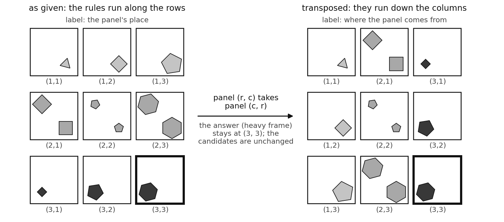

# Chapter 8. Discussion and conclusion (draft, 2026-11-14)

## 8.1 What a symmetry is worth

The thesis asked what a built-in symmetry is worth to a relational model, and whether that can be known before
training. The answer the experiments give is a count with two sides and a condition.

Where the rule gives corresponding answers on the inputs a symmetry merges, the symmetry is worth the
data it lets the model reuse. Where it does not, it is worth a ceiling. Both are numbers of orbits on the rule's table,
and both were written down before the runs. The saving matters most in practice, because it is largest exactly where
data is scarce and fades as data grows: tens of points at 100 to 600 training puzzles, a few at 6,000 (Section 6.2).
Counted in puzzles rather than points, it is the size of the group the data really has. For the attributes that is
two to three, not the three of the group the model was given, because type never carries Arithmetic; the runs needed
that much data. The ceiling showed up twice: a reflection held a model near half of all values (Section 6.7), and the
shift held one at 7% on sums against the 7.9% counted (Section 7.4).

The condition is on the learner. The count describes a learner that shares nothing across orbits and can tell every orbit apart. Our
value models share nothing across orbits by construction, so they got the rows the count allows and none of the others
(Section 7.5); that part follows from their weights. Whether a network also tells the orbits apart depends on how it
reads the puzzle. With the first row descriptor the same group and the same count gave 20% or 100% (Section 7.7), and
with the shift alone the network stays 20 points under the count at 100 puzzles, for a reason we did not find. The
ceiling has a condition of the same kind: it belongs to the shift together with reading the answer from the question
row, not to the shift alone (Section 3.6.3). The count bounds what a model of a given family can reach and orders the
models by the data they need. It does not by itself give a network's accuracy.

So the answer to the second half of the question is yes, to the extent that the rule's table is known and the way the
model reads the puzzle is part of what is counted. For a generated benchmark both are known. For a task where they are not, the count still says what to look for: the worth of a
symmetry prior is a property of the pair of model and task, and a prior that helps on one rule can cap the model on
its neighbour.

## 8.2 Which symmetry, not how much

It is tempting to summarise Chapter 7 as "Arithmetic is hard because it has no symmetry". That is false, and the
difference matters. Sum has as many moves that keep its rows valid as midpoint has. What it lacks is one particular
move, the common shift, and that happens to be the move a convolution along the values builds in. Given its own
moves, sum is the easier rule of the two.

The practical reading is that "more equivariance" is not a direction in which models improve. The convolution is the
natural symmetry to put on a line of values, three of the benchmark's four rules have it, and on the fourth it turns a
model that would have learned slowly into one that cannot learn at all. A designer who adds a symmetry is betting that
every rule in the task shares it. The bet can be checked beforehand, by transforming valid examples and asking
whether they stay valid and whether the answer moves with them (Section 3.5), and the stakes can be counted.

The same holds in the other direction. Midpoint keeps the shift and also scaling, and a model given both needs less
data at every step: from 59.9% with the shift alone to 100% with scaling at 100 puzzles, once its row descriptor could
read the steps of the complete rows (Sections 7.7 and 7.8). More of a rule's own symmetry helps; a symmetry the rule
lacks caps.

## 8.3 Sharing and invariance are two things

Building a symmetry in gives a model two properties at once: its weights are shared across the things the symmetry
exchanges, and its output is exactly invariant. The label experiments separate them. A model that shares its weights
and is not invariant learns as fast as the invariant model on puzzles like the training ones (Section 6.3). It fails
where the training data stops: on a rule never seen on an attribute it loses 44 points where the invariant model loses
5 (Section 6.4), and where the generator leaves room, it learns the generator's regularity in place of the rule
(Section 6.5). A symmetry in that room can also pay on the benchmark itself: the order of Arithmetic's operands,
which the generator never varies, adds 7 points at 6,000 puzzles and doubles the exact sums (Section 6.6).

Sharing, then, is what saves data, and invariance is what carries the model beyond its data. For a benchmark score
only the first is needed, which is one reason a benchmark score says little about the second.

## 8.4 Where the priors came from

Every prior in this thesis was chosen by someone who had read the generator. The first objection to all of the above
is therefore that the answer key was copied into the model. Chollet (2019) gives the terms for an honest reply. Skill
can be bought with priors, and "unlimited priors allow system developers to 'buy' unbounded performance on any given
task" (p. 25). A fair test may assume a short list of them, including objects, elementary geometry, and numbers, which "may be
added or subtracted" (p. 26), with quantities "smaller than approximately 10" in his own benchmark (p. 49). And
generating every task from one program is "a weakness", since reverse-engineering the program would solve them all
(p. 51). RAVEN is generated from one program.

We sort our priors by whether a person would bring them to any test of this kind, or whether they are read off this
generator.

| prior | built in by | kind |
|---|---|---|
| objects are units; their order means nothing | objects as nodes | general |
| the same rule holds in every row | rows 1 and 2 not named | general |
| any attribute can carry a rule | the attribute as a variable | general |
| only differences between values matter | the value axis | general |
| addition | `plus` facts | general for small numbers; beyond the list for values up to 50 |
| the two components of a layout behave alike | the component as a variable | generator |
| the list of attributes and their ranges | the input encoding | generator |
| the middle columns are operands | column roles | generator |
| rules run along rows, never columns | row facts in every model | generator |

Read by kind, the prices are suggestive. The largest gains belong to general priors: the shift of values (61 points at
100 puzzles), addition (sum from 5% to 98%), and a graph with a node per attribute (86% against 30% at 300 puzzles,
Section 5.4). The generator's priors bought less, and what they bought was gone at full data: 14 points for the
components at 100 puzzles, none at 6,000. This is a comparison across different models and datasets, and we do not
lean on it.

One generator prior is in every model here, ours and the baselines alike: that rules run along rows. Transposing an
I-RAVEN matrix leaves 3% of Progression instances valid (Section 3.5), so a model with rows as facts should fail on a
transposed puzzle that a person would not notice had changed. It does. On transposed puzzles the facet model, the
model with copy links and the row fold all fall from 95.8–97.4% to 45.0–45.1% matched, and to about 4% exact. RAVEN's
rules applied along rows keep 47.7% of the same kind of puzzles, so the models fail as a perfect row-rule solver fails (Figure 8.1 shows a transposed puzzle). This is the prior's cost away from the generator; its worth in training data was not measured. It limits what every score in this thesis means: accuracy on the generator's own distribution, bought partly
with the generator's own structure. Nothing here is a claim about the tests people take.

## 8.5 What the lifted template contributes

**Not accuracy.** A graph network in PyTorch with the same symmetries is within half a point of the facet model on
I-RAVEN (Section 5.5). The gains reported in this thesis belong to the symmetries and to the graph.

**A uniform way to state and prove a symmetry.** In the template, a symmetry is the absence of a name. One theorem
covers every case, and each was confirmed on random weights to machine precision. The baseline's symmetries were
engineered into its node features one at a time, and each needed its own check. The ablations of Chapter 6 are changes
of a line in the template: add a fact that labels a component, or write a rule once per attribute. This is a difference
in uniformity and convenience, not in what can be built: in a tensor framework, sharing weights over a set or a typed
axis is also one line, and equivariant layers come with their own proofs.

**Relations of more than two things, used by learned rules.** `plus(U, W, V)` joins three values. In the template it
is a fact like any other, and rules with weights walk through it (Section 7.6). A graph network that passes messages
along pairs needs extra nodes for the triples to do the same, as networks on hypergraphs or factor graphs have; in the
template no change of architecture is needed.

**Recursion.** The `plus` facts need not be given as a table. Two rules without weights derive them from the zero and
the successor of each value, u + 0 = u and u + (w + 1) = (u + w) + 1, and the model's outputs are then identical to
those with the table, to 2·10⁻¹⁶. The recursive rule is itself sum's symmetry: move one operand by one and the answer
moves by one. All that a model needs to know about addition thus fits in a zero, a successor and one rule. It is
written in and not learned, since weights cannot change which facts are derived, and it costs 22 times the grounding
time on rows of 10.

**A cost.** Every puzzle becomes its own network, kept in memory, and trained one at a time on CPU: over 300 GB and
about 15 hours for a run on all of I-RAVEN, where the PyTorch baselines need one GPU and a few gigabytes (Section 5.8).
Background facts cost too: the `plus` facts grow with the square of the value range.

## 8.6 Limits

- **One seed.** Most numbers are a single training run. Where two seeds exist they differ by 1 to 2 points.
  Sum and midpoint at 100 and 600 puzzles have three, with standard deviations of 0.4 to 3.9 points for the
  models of Sections 7.4 to 7.6. So do Chapter 6's comparisons with little data and the attributes at 6,000: standard
  deviations of 0.2 to 2.7 points, and each seed's gain within 2 points of the mean gain (+14.2, +13.5, +6.3). The
  vision transformer varies more: its gain from the exchange of rows is 7.6 to 28.0 points across three seeds. The first scaled model of Section 7.7 had two outcomes, 100% at one seed and about 20%
  at two, which went with whether its row descriptor carried the rule; with a descriptor that reads the steps it is at
  100% in six runs of six.
  The conclusions rest on effects of 10 to 60 points and on their direction, not on differences of a point or two;
  the 0.4 points between the facet model and its PyTorch counterpart is not a result.
- **The value axis is given the rules' primitives.** Its results are comparisons with itself. The symmetry on values,
  the centre of Chapters 6 and 7, has not been built into a model that learns the rules from codes. With `plus` given,
  learning sum is choosing a given relation, as in models with programmed rules, and the facts grow with the square of
  the range: the value axis was not run on values up to 1,000.
- **One object per panel on I-RAVEN-X, and rows of 3 for the twins.** The orbit count was tested on tables of about
  1,250 rows. That it explains the difficulty of Arithmetic on rows of 10 is an inference.
- **The count needs the rule's table, and describes one kind of learner.** It was made on finite tables, where the
  groups hold only away from the ends of the range, and on a ring of 101 values where they hold exactly. It bounds a
  learner that shares nothing across orbits; how close a network comes depends on how it reads the puzzle (Section 8.1).
- **Rows of 10 are not compared across model families.** The runs differ in training length and recipe (Section 5.7).
- **Perception is trained apart**, with labelled objects, and the reasoning model cannot take graded inputs as it
  stands (Section 5.3). The pipeline is end to end at test time only, and its labels give it more supervision than the
  black-box transformer gets (Section 5.4).
- **The fixed encoding.** Thermometer codes tie the facet model to the value range it was trained on, and the list of
  attributes is given.
- **The I-RAVEN-X test pass came last.** The text reports puzzles 6300 to 7299, which were looked at throughout the
  work. Every final checkpoint of Chapters 5 to 7 was scored once on puzzles 8000 to 9999 only at the end, after an
  external review asked for it (Appendix D.6). The test numbers agree with the reported ones within sampling error,
  except the facet model on sum at 600 puzzles, a single run, 24.7 against 31.2. Column roles' Arithmetic, the model
  chosen with the unseen puzzles in view, drops from 39.6 to 36.0, within sampling error but at every seed.
- **One generator.** Section 8.4.

## 8.7 Future work

1. **Sum from differences, across rows.** A complete sum row shows where zero is, because c − b equals a. A function
   built from differences alone, c₃ = b₃ + (c₁ − b₁) + (a₃ − a₁), is right on every sum puzzle and follows a shift of
   the whole puzzle (Section 7.3). Our templates never measure from the question row to another row, which is why
   the shift caps them on sum. A kernel between a panel and the panel above it would give the model those offsets.
   The question is whether it then learns sum with the shift built in and without the `plus` facts. (The item that
   stood here, a row descriptor that reads each pair's step, was built and is Section 7.7's repair: the scaled model
   then learns midpoint at every seed, so the cost measured there belonged to the descriptor and not to the
   symmetry. On sum it changes nothing, as predicted.) One caution: the function above chains two offsets, and a
   template that chains offsets for every answer contains it by construction. The test means something only if the
   chain is the same for every rule and the model still has to find which offsets to chain.
2. **Pricing "rows only".** The cost on transposed puzzles is measured (Section 8.4). What remains is its worth in
   data: replace rows by lines, with rows and columns both given as facts, so that the direction of a rule is
   inferred per attribute, and compare the two models at a few training sizes.
3. **Training perception and reasoning together.** The recognizer's output, the probability that a value exceeds each
   threshold, is already a soft thermometer code. The template has to lose its jump at zero first.
4. **The value axis on grids.** Position slots as constants with the geometry of the grid as background facts, and
   the number of objects as a line of its own, where Progression on positions is a cyclic shift.
5. **Learning the rule that derives addition.** The recursion of Section 8.5 is written by hand. Finding it would be
   learning the structure of a template, not its weights.

## 8.8 Conclusion

A built-in symmetry is worth the orbits it merges. Where the rule respects the symmetry, the model learns one answer
per orbit and needs correspondingly less data; where it does not, the model is right on one input per orbit and no
data helps. Both can be counted before training. In our experiments the trained networks sat at the counted ceiling,
needed the counted amount of extra data where the models were otherwise equal, and came close to the counted saving
once they could tell the orbits apart.

In a lifted relational template these symmetries are declared by leaving things unnamed, and hold exactly. A model
built this way generates the answers of I-RAVEN without the rules and without the candidates: 97.2% on the test
split from object labels and 97.0% end to end behind an object recognizer, against 93.1% for a vision transformer
with six times the weights, and 90% against 16% when each layout has 300 training puzzles, end to end as from
labels. The recognizer learns from labelled objects and the transformer from the answer alone, so that gap is what
the object representation and its labels are worth together. A graph network with the
same symmetries does as well, so the credit goes to the structure and not to the framework.

The assignment asked for symmetry-aware architectures that combine object recognition with priors on how objects
compose, built on relational neural networks, and for an improvement over black-box vision. Chapters 3 and 4 give the
architectures and Section 4.3 the recognition; Chapter 5 gives the improvement, largest where data is scarce; and
Chapters 6 and 7 measure, prior by prior, what was bought and what a wrong choice would have cost.
